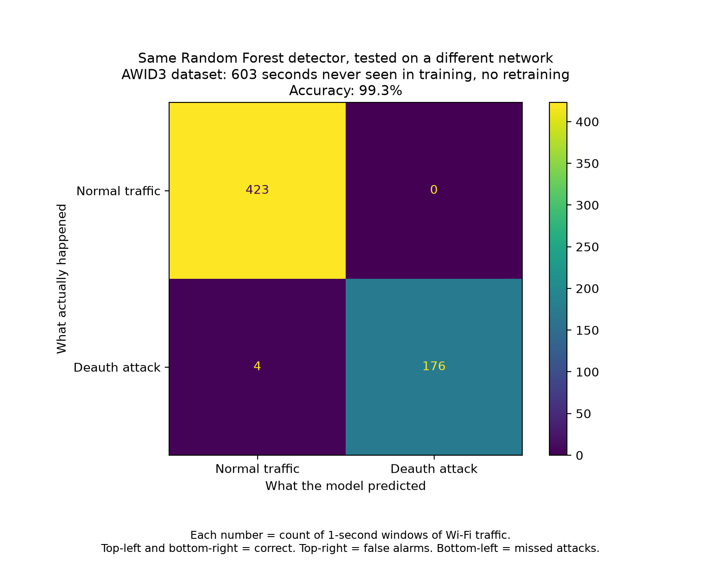

# Wireless Intrusion Detection

This project trains a Random Forest classifier to identify Wi-Fi deauthentication attacks. It converts packet-level Wi-Fi traffic into one-second windows, calculates traffic features for each window, and predicts whether that window is normal or an attack.

The repository includes a pretrained model. The detector analyzes a packet capture and prints normal-window messages or attack alerts. It records the top deauthentication sender in `blocklist.log`; it does **not** configure a firewall or block network traffic.

## Requirements

Install Python 3 and the project dependencies:

```bash
python -m pip install pandas matplotlib joblib scikit-learn scapy
```

Clone the repository and run commands from the directory containing the relevant script and model. The scripts use paths relative to their current working directory.

## Run the pretrained detector

From `WPA3 Attacks Dataset/WPA3 Denial of Service attacks/Deauthentication attack`, pass a Wireshark-compatible PCAP containing 802.11 packets:

```bash
python detector.py path/to/capture.pcap
```

To process a time range and pause one second after each processed window:

```bash
python detector.py path/to/capture.pcap --start 0 --seconds 60 --live
```

`--start` is the offset in seconds from the beginning of the capture, and `--seconds` is the maximum duration to process. The detector loads `wids_model.joblib` from the current directory. Alerts are printed to the terminal and the top sender is appended to `blocklist.log`.

## Train the model

### Training data

Training requires a labeled `Deauth.csv` in the `Deauthentication attack` directory. The CSV must contain these columns:

- `frame.time_relative`
- `frame.len`
- `radiotap.dbm_antsignal`
- `wlan.fc.type_subtype`
- `wlan.fc.retry`
- `Label`

The raw capture and CSV are not included in the repository. Obtain the WPA3 deauthentication capture from the [WPA3 Attacks Dataset on Mendeley Data](https://data.mendeley.com/datasets/cxx5t5nw7z/1), then prepare/export a labeled CSV with the required columns. Place it at `WPA3 Attacks Dataset/WPA3 Denial of Service attacks/Deauthentication attack/Deauth.csv`.

### Training procedure

Run the training script from its directory:

```bash
cd "WPA3 Attacks Dataset/WPA3 Denial of Service attacks/Deauthentication attack"
python train.py
```

The script groups frames into one-second windows. It uses total frame count, deauthentication frame count and ratio, average signal strength, average frame length, and retry ratio as features. A window is labeled as an attack if it contains a frame labeled `Deauth`. Missing feature values are filled with the feature medians.

The main model is a 100-tree Random Forest trained on a stratified random 70/30 split of the windows (`random_state=42`). The script reports classification metrics, saves the model as `wids_model.joblib`, saves the generated feature table as `features.csv`, and writes the random-split plot `CM_WPA3_test.png`.

The script also runs a separate diagnostic experiment: it trains on the first 70% of windows and tests on the last 30%, using features that exclude deauthentication frame count and ratio. This experiment is for comparison; it does not replace the saved main model. It writes `CM_WPA3_timesplit_no_deauth.png`.

## Evaluate on AWID3

The AWID3 evaluation tests a saved WPA3 model on a different dataset without retraining. It requires the AWID3 deauthentication CSV exports named `Deauth_0.csv`, `Deauth_1.csv`, and so on, in `AWID3_Dataset_CSV/CSV/1.Deauth`. Each file must contain `frame.time_epoch`, `wlan.fc.type`, `wlan.fc.subtype`, `frame.len`, `radiotap.dbm_antsignal`, `wlan.fc.retry`, and `Label`. The script also loads `wids_model.joblib` from that same directory.

The repository includes the trained model in both directories. If you have just retrained the WPA3 model and want to evaluate that updated model on AWID3, copy it into the AWID3 directory before running the evaluation:

```bash
cp "../../../WPA3 Attacks Dataset/WPA3 Denial of Service attacks/Deauthentication attack/wids_model.joblib" wids_model.joblib
```

Run it from the AWID3 directory:

```bash
cd "AWID3_Dataset_CSV/CSV/1.Deauth"
python eval_awid3.py
```

The script creates one-second features from the AWID3 CSVs, reports accuracy and classification metrics, lists misclassified windows, and saves `features_awid3.csv` and `CM_AWID3_test.png`.

## Confusion matrices

Each matrix counts one-second windows. The vertical axis is the actual label and the horizontal axis is the model prediction:

| Cell | Meaning |
|---|---|
| Top-left | Normal windows correctly predicted as normal |
| Top-right | Normal windows incorrectly flagged as attacks (false alarms) |
| Bottom-left | Attack windows incorrectly predicted as normal (missed attacks) |
| Bottom-right | Attack windows correctly detected |

### WPA3 random holdout


This matrix evaluates the main Random Forest on the randomly held-out 30% of WPA3 windows: 164 normal and 112 attack windows were correctly classified, with no errors (100% accuracy). Since the split is random across windows from the same capture, it is not an independent-network test.

### WPA3 time-based holdout without deauthentication-count features


This is the separate diagnostic model trained on the first 70% of the capture and tested on the last 30%, without deauthentication frame count or ratio. It correctly classified 77 normal and 96 attack windows, raised 2 false alarms, and missed 1 attack (98.9% accuracy). This checks whether other traffic features can distinguish the classes over time.

### AWID3 cross-dataset evaluation



This evaluates the saved WPA3 model on 603 AWID3 windows without retraining. It correctly classified 423 normal and 176 attack windows, raised no false alarms, and missed 4 attacks (99.3% accuracy). It measures performance on this AWID3 export; it should not be treated as a guarantee of performance on other networks or captures.
